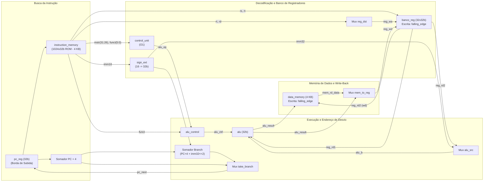
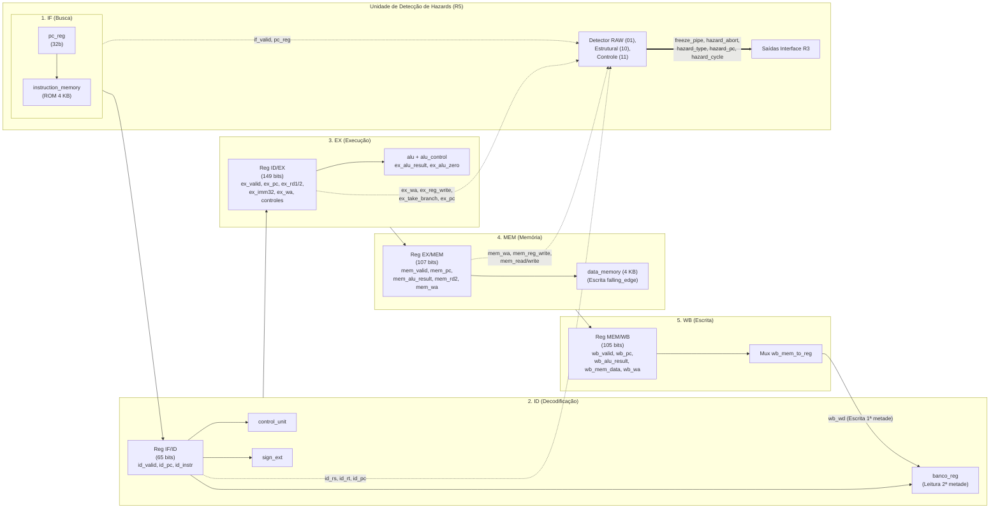

# Diagramas de Blocos das Organizações O1 (Monociclo) e O2 (Pipeline de 5 Estágios) (Issue #20)

Representação estrutural completa dos caminhos de dados, unidades de controle, multiplexadores e sinais da interface **R3** para ambas as organizações implementadas.

---

## 1. Diagrama de Blocos da Organização O1 (Monociclo — `o1/cpu_top.vhd`)

---

## 2. Diagrama de Blocos da Organização O2 (Pipeline 5 Estágios — `o2/cpu_top.vhd`)

